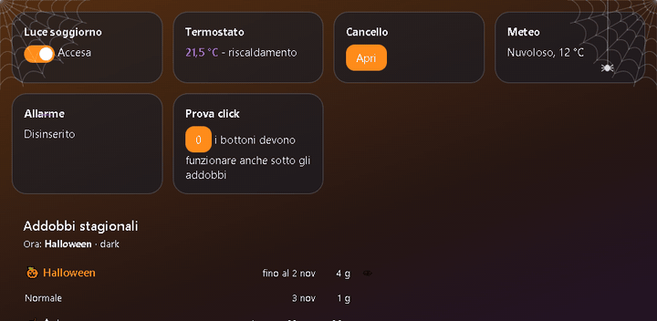
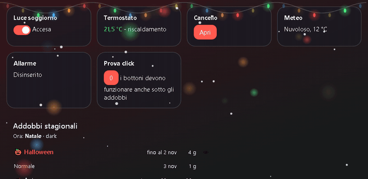
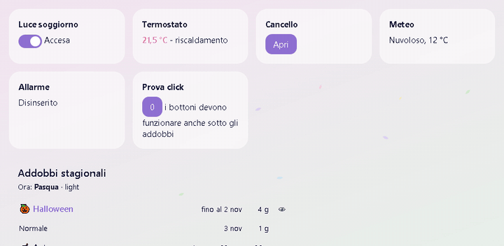
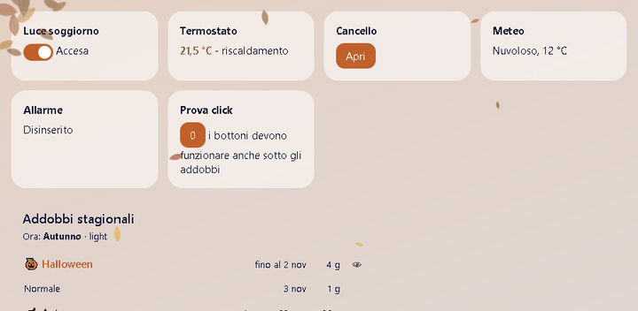
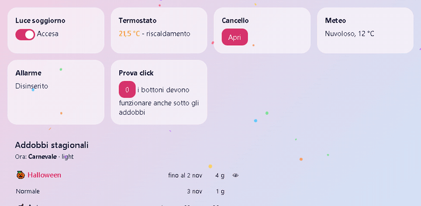

# Seasonal Glass 🎃🎄🐣

**Your Home Assistant dashboard decorates itself for every season and holiday.**

Seasonal Glass is a lightweight Lovelace frontend plugin. You install it once and forget it:
throughout the year it gently restyles your dashboard. The accent palette changes, a seasonal
background can appear, and subtle decorations and animations come and go on their own.

<p align="center">
  
  
  
  
</p>
<p align="center"></p>
<p align="center"><sub>Real recordings of the built-in preview. Taps and buttons keep working under every decoration.</sub></p>

| | Light | Dark |
|---|---|---|
| 🎃 Halloween | cobwebs (one in the corner, one half-moon on the side), a dangling spider, bats | same, tuned for dark |
| 🎄 Christmas | string lights, swinging baubles on the sides, twinkling bokeh lights, snow | same, glowing |
| 🐣 Easter | decorated eggs in the grass that wobble, pastel petals | |
| 🎭 Carnival | confetti | |
| 🎆 New Year's Eve | small fireworks at the top of the screen, golden lights | brighter |
| 💘 Valentine's Day | falling hearts | |
| 🎂 Your own days | birthdays, anniversaries: confetti in the color you pick | |
| 🌱 Spring · ☀️ Summer · 🍂 Autumn · ❄️ Winter | sprouts · sea/sun palette · dry leaves · snow | fireflies on summer nights |

## The concept

1. **Your theme stays yours.** Seasonal Glass doesn't replace your theme. It overrides only a few
   CSS variables, the accent colors and optionally the background, and draws its decorations on top.
2. **It never gets in the way.** Every decoration lives on one full-screen layer with
   `pointer-events: none`: you can tap "through" a cobweb. Dialogs stay above it.
3. **Light and dark, always.** Every season has a light and a dark variant. The plugin *detects*
   whether your current theme is light or dark, so it follows any day/night switching you
   already have (see the automation below).
4. **It runs on a calendar that maintains itself.** Dates are recomputed every year, including
   movable feasts: Easter uses the Meeus algorithm, and Carnival follows it.
5. **Seasons are the background, holidays the highlights.** The four seasons start 10 days before
   their equinox or solstice and cover the year. Holidays sit on top of them and appear at least
   10 days before the actual day.
6. **"Normal" days in between.** When one decoration would follow another directly, the first day(s)
   of the new one are left plain, so the dashboard "breathes" between themes. The default is 1 day.
   It is configurable.
7. **One folder = one season.** Everything about a season (dates, colors, effects, images) lives
   in its own folder. To add a season, add a folder.
8. **Light enough for tablets and Chromecast.** It runs at about 30 fps, pauses in hidden tabs,
   honors `prefers-reduced-motion`, and sizes everything relative to the short side of the screen,
   so it works in portrait and landscape.

## Default calendar

| Period | From | To |
|---|---|---|
| ❄️ Winter | Dec 11 | Mar 9 |
| 🎭 Carnival | Fat Thursday (Easter −52) | Shrove Tuesday (Easter −47) |
| 🌱 Spring | Mar 10 | Jun 10 |
| 🐣 Easter | Easter −10 | Easter Monday |
| ☀️ Summer | Jun 11 | Sep 11 |
| 🍂 Autumn | Sep 12 | Dec 10 |
| 🎃 Halloween | Oct 21 | Nov 2 |
| 🎄 Christmas | Dec 1 | Jan 6 |
| 🎆 New Year's Eve | Dec 31 | Jan 1 |
| 💘 Valentine's Day | Feb 12 | Feb 14 |

Example year (2027), with 1 normal day between periods:
Christmas → *normal* → Winter → *normal* → Carnival → *normal* → Winter → *normal* → Spring →
*normal* → Easter → *normal* → Spring → *normal* → Summer → *normal* → Autumn → *normal* →
Halloween → *normal* → Autumn → *normal* → Christmas.

New Year's Eve, Valentine's Day and your own days are short: they interrupt the current period and hand it back
the next day, without normal days (Christmas → New Year's Eve → Christmas).

## Installation

### As an integration (recommended)
1. **HACS** → ⋮ → Custom repositories → add this repo with category **Integration**, then download *Seasonal Glass*.
   To install manually instead, copy `custom_components/seasonal_glass` into `<config>/custom_components/`.
2. Restart Home Assistant.
3. Go to **Settings → Devices & services → Add integration → Seasonal Glass**.

The integration loads the plugin on every dashboard by itself, so you don't add a Lovelace resource.

### Settings, like any integration
**Settings → Devices & services → Seasonal Glass → Configure**:
- **General**
  - **Animations:** *Follow the device* (default: still image if the device asks to "reduce motion"), *Always* or *Never*
  - **Normal days between two decorations**
  - **Active periods:** tick the seasons and holidays you want
- **Period dates:** a start and end field for every period, with the automatic dates shown for reference.
  Use `MM-DD` or `P-10` / `P+3` (days from Easter). Leave a field empty to keep it automatic.
- **Colors:** pick a period, then its main color (light/dark), tint color (light/dark) and tint intensity
  (0 = no tint). "Restore default colors" undoes it.
- **Personal days:** birthdays, anniversaries, one per line: `MM-DD Name emoji #color` (emoji and color optional).
  ```
  03-15 Marta's birthday 🎂 #8e44ad
  06-21 Anniversary 💍
  ```

- **Notify when the decoration changes** (General, on by default): a Home Assistant notification when the period changes.

### Entities and service
- **`sensor.seasonal_glass_periodo`**: the current period (`Halloween`, `Normale`...). Attributes: `fine` (last day),
  `prossimo`, `prossimo_inizio`, `giorni_al_prossimo`, handy for automations ("turn on the Christmas lights when the
  period starts", "3 days to Halloween").
- **`calendar.seasonal_glass`**: every period as an all-day event, in the Calendar panel and usable with calendar triggers.
- **`seasonal_glass.anteprima`**: shows a period on every device (kiosk included) for a few minutes, then goes back to automatic:
  ```yaml
  action: seasonal_glass.anteprima
  data:
    periodo: natale     # folder name, ricorrenza_1, or normale
    minuti: 10          # 0 = cancel
  ```

Press **Save and close** at the end. Every device picks up the change within 2 minutes, with no restart.
Folders you add to `periodi/` appear in these menus automatically after `python build.py`.

### Plugin only (no integration)
1. Copy the contents of `dist/` to `<config>/www/seasonal-glass/`.
2. Go to Settings → Dashboards → ⋮ → Resources, and add `/local/seasonal-glass/seasonal-glass.js` as a **JavaScript module**.
3. Reload the browser. Settings are then made in the card YAML (see below).

## Day/night: the automation that pairs with it

Seasonal Glass doesn't switch themes. It only follows them. If you want the dashboard light during
the day and dark at night, use any theme automation you like. The plugin detects the mode from the
theme name (`dark`, `light`, …). If the name doesn't say, it looks at the background brightness.

This example follows the sun with the [Frosted Glass](https://github.com/wessamlauf/homeassistant-frosted-glass-themes) themes:

```yaml
automation:
  - alias: "Dashboard theme follows the sun"
    mode: single
    triggers:
      - trigger: numeric_state
        entity_id: sun.sun
        attribute: elevation
        below: -2
      - trigger: numeric_state
        entity_id: sun.sun
        attribute: elevation
        above: -2
      - trigger: homeassistant
        event: start
    actions:
      - action: frontend.set_theme
        data:
          name: >
            
              Frosted Glass Light
            
              Frosted Glass Dark
            
```

When the theme changes, the seasonal decorations switch to their light or dark variant instantly,
with no reload.

## The calendar card

The same file also provides a card that shows the calendar as computed: the current period,
every upcoming period and the "normal" days between them, with dates and durations.

```yaml
type: custom:seasonal-glass-card
mostra: 12                 # rows to show
```

- 👁 next to a period previews it **on this device only**. Use "Back to automatic" to undo it.
- **Manual changes.** Everything is automatic by default. The easiest way to change it is the integration's
  **Configure** menu. You can also edit the card's YAML; card values take precedence over the integration.
  The overrides apply to **every device**, because the plugin reads them from the dashboard even
  where the card isn't shown:

```yaml
type: custom:seasonal-glass-card
giorni_normale: 2          # plain days between two decorations
periodi:
  natale:   { da: "11-25" }           # Christmas from Nov 25 (+ the normal day(s))
  pasqua:   { pasqua: [-14, 1] }      # Easter from 14 days before
  estate:   { disattivo: true }       # no summer decorations
  halloween: { da: "10-15", a: "11-01", priorita: 40 }
```
Overridden periods show a **manual** badge. Remove the lines to go back to automatic.
By default the plugin looks for the card in the default dashboard. For another dashboard, set
`window.seasonalGlass = { dashboard: 'my-dashboard' }`.

## Try it / force a period
Add these to the dashboard URL:
- `?addobbi=natale`: force a period, using its folder name (`natale`, `halloween`, `pasqua`, `carnevale`, `primavera`, `estate`, `autunno`, `inverno`, `capodanno`, `san-valentino`)
- `?addobbi=natale&modo=dark`: also force dark mode
- `?addobbi=off`: normal, no decorations

Or call the `seasonal_glass.anteprima` service to preview on every device at once.
Or open `anteprima.html` locally to preview every period, light and dark, without Home Assistant.

## Make your own period
```
periodi/my-period/
  periodo.json
  sfondo.png               # optional background (or sfondo-light.png + sfondo-dark.png)
  decorazioni/             # optional images, positioned by FILE NAME:
    alto-sinistra.png      #   top-left (also alto-destra, basso-sinistra, basso-destra, alto-centro, basso-centro)
    alto-sinistra.dark.png #   dark-mode variant
  effetto.js               # optional custom effect
```
```json
{
  "nome": "Halloween",
  "priorita": 20,
  "date": { "da": "10-20", "a": "11-02" },
  "colori": {
    "light": { "primary-color": "#e8730c", "accent-color": "#7b3fa0" },
    "dark":  { "primary-color": "#ff8c1a", "accent-color": "#a66bd3" }
  },
  "effetti": [ { "tipo": "ragnatele" }, { "tipo": "pipistrelli", "quantita": 3 } ]
}
```
- **Dates:** each bound is `"MM-DD"` or `{ "pasqua": n }` (n days from Easter, negative = before). Ranges may wrap around New Year.
- **Priority:** when periods overlap, the higher `priorita` wins. Holidays sit above seasons.
- **No buffer** (`"senza_pausa": true`, optional): for short periods; no normal days when entering or leaving them.
- **Colors:** any theme CSS variable, written without `--`.
- **Tint** (`velatura`, optional): `{ "light": "<color or CSS gradient>", "dark": "..." }`, laid semi-transparent over your theme's own background (`--background-image`). Ignored when the period has its own `sfondo`.
- **Built-in effects:**
  - Falling or moving: `neve` (snow), `foglie` (leaves), `petali` (petals), `coriandoli` (confetti), `cuori` (hearts), `pipistrelli` (bats), `lucciole` (fireflies)
  - Sky: `fuochi` (fireworks in the top band: `intervallo` seconds, `altezza` 0-1 of the screen)
  - Lights: `lucine` (`stile`: `filo` = string lights, `bokeh` = soft twinkling dots)
  - Hanging: `palline` (Christmas baubles, `lati`: `sinistra`/`destra`)
  - Corners: `ragnatele` (cobwebs, `ragno`: spider, `forme`: per corner `angolo` / `allungata` / `semicerchio`), `germogli` (sprouts), `fogliame` (dry leaves), `uova` (eggs)
  - Common options: `quantita`, `opacita`, `solo: "light" | "dark"`, `kiosk: false` (skip on pages outside Lovelace); for corner effects also `angoli`, `dimensione`
- Then run `python build.py`. A folder starting with `_` is ignored, which is handy for disabling a period.

**Settings** (`impostazioni.json`):
```json
{ "giorni_normale": 1, "movimento": "auto" }
```
`giorni_normale` is how many plain days separate two decorations that would otherwise touch (minimum 1).

**Custom effect** (`effetto.js`):
```js
export default function (ctx) {          // ctx = { dark, livello, periodo }
  const el = document.createElement('div');
  ctx.livello.appendChild(el);            // livello: fixed full-screen layer, pointer-events none
  return () => el.remove();               // cleanup when the period or mode changes
}
```

## Outside Lovelace (kiosk pages, screensavers)
```html
<script>window.seasonalGlass = { modo: 'dark' };</script>  <!-- 'light', 'dark' or a function returning true when dark -->
<script type="module" src="/local/seasonal-glass/seasonal-glass.js"></script>
```
The plugin also sets `--seasonal-glass-velatura` (the tint) and `--seasonal-glass-colore` (the main color) on `html`,
so such a page can use them, e.g. `background: var(--seasonal-glass-velatura, linear-gradient(transparent,transparent)), <your background>;`.

## Credits
Inspired by the glass themes of Wessam Lauf ([Frosted Glass](https://github.com/wessamlauf/homeassistant-frosted-glass-themes))
and Nezz / Adam Kapos / Bas Nijholt ([visionOS / liquid glass](https://github.com/Nezz/homeassistant-visionos-theme)), both MIT.
No code from them is included. All decorations are drawn in code; any images are original or freely licensed.

## License
MIT

---

<p align="center">
  ⭐ <b>If Seasonal Glass made your dashboard smile, please star the repo!</b> ⭐<br>
  It helps other Home Assistant users find it. Ideas and new periods are welcome in the issues.
</p>
